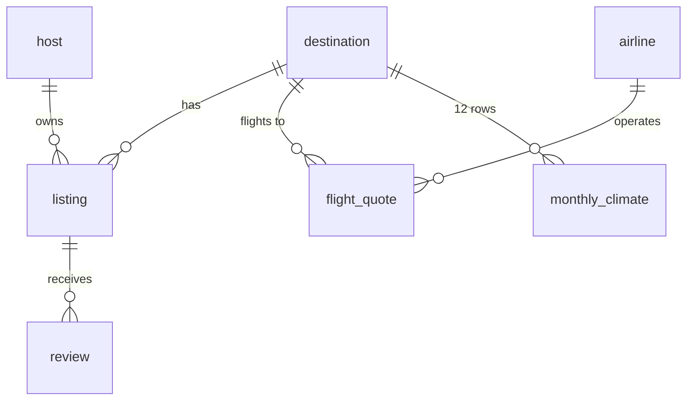

# AI-Based Data Analysis for a Travel & Holiday Planner
*Group project – Evaluation 2. Decision question: **How should a travel-planner business (price-comparison / trip-bundling service) help budget-conscious Irish travellers choose where and when to go, and how should it position its product?***

> **Data honesty note (read first).** Airbnb and Skyscanner offer no open bulk data (scraping Airbnb breaches its terms; Skyscanner requires a partner API key), and the sandbox could not reach Inside Airbnb. The dataset is therefore **simulated** (`src/generate_data.py`, seed 42) to follow the *real field structures* of Inside Airbnb `listings.csv`/`calendar.csv` and Skyscanner flight quotes, with deliberately injected quality problems. Because relationships were built in, **figures below demonstrate the method and plausible magnitudes – they are not market findings.** To get real findings, load Inside Airbnb CSVs into `listing` and Skyscanner/Kiwi API quotes into `flight_quote` and re-run `python src/analysis.py` – nothing else changes. Your group should state this limitation in the presentation.

## 1. Database Design & Data Management (25%)

**Model:** normalised SQLite database (3NF), `sql/schema.sql`, 7 tables, 3 indexes, 1 analytical view, PK/FK/CHECK constraints.



| Table | Source analogue | Rows | Key fields |
|---|---|---|---|
| destination | curated | 20 | cost_index, distance_km, climate_zone |
| host / listing | Inside Airbnb | 2,500 / 6,060 | room_type, price_night, rating, dist_centre_km |
| review | Inside Airbnb reviews | 15,000 | stars, comment (text) |
| airline / flight_quote | Skyscanner | 8 / 30,000 | price_eur, days_before, stops, carrier_type |
| monthly_climate | Inside Airbnb calendar + weather | 240 | avg_temp_c, rainfall_mm, occupancy_pct, price_index |

**Design decisions:** host split from listing (removes repetition, enables the superhost analysis); airline split so carrier type is stored once; `v_trip_cost` view encodes the business metric (flight + 5 nights × seasonal price) once for everyone; CHECK constraints reject impossible values; nullable `price_night`/`rating` represent genuine missingness rather than fake zeros.

**Data preparation (logged in `outputs/results.json`):** 6,060 raw listings → 60 duplicates removed → 150 missing prices dropped → 42 outliers removed (3×IQR on log-price within destination × room type, catching ×15 entry errors) → **5,808 clean listings**. Ratings left null where no reviews exist and median-imputed only for the ML model. Flight quotes: 30,000, short-haul subset (<8,000 km) used for like-for-like comparisons.

## 2. Digital & AI Competency (30%)

**Pipeline:** SQL (schema, joins, view) → pandas cleaning → `scipy`/`statsmodels` inference → `scikit-learn` modelling → text mining → decision tool.

| Technique | Purpose | Result |
|---|---|---|
| Welch t-test | Superhost price premium | ≈ +12% (65 vs 59 € median), p < 0.001 |
| ANOVA + Kruskal-Wallis | Price by room type | Medians: entire home 75 €, hotel 63 €, private 40 €, shared 24 €; p ≈ 0 |
| Mann-Whitney | Low-cost vs full-service fares | 70 € vs 113 € median, p ≈ 0 |
| Kruskal-Wallis | Seasonal flight prices | Summer 112 € vs spring 89 €, p < 0.001 |
| Spearman correlation | Drivers of price | bedrooms +0.32, distance to centre −0.13, rating only +0.08 |
| OLS log-price (robust SE), R² = 0.71 | Explain price | Superhost +10% (robust SE), each km from centre −3.5%, each amenity +0.4%, price ∝ destination cost index (elasticity ≈ 1.0) |
| Random forest vs linear model | Predict price | RF R² 0.69 (CV 0.69, MAE ≈ 16 €) – **did not beat the linear model (0.71)**, so the simpler model is preferred |
| K-means on destinations (k by silhouette, k=3, 0.34) | Segmentation | see §3 |
| TF-IDF + NMF, complaint counting | Review text mining | Praise: value, location, cleanliness, helpful host; top complaints: misleading photos, slow host replies, hard to find, dirty on arrival |
| Planner function `plan(budget, month)` | Decision support | Returns best-value destinations for a budget/month/temperature band |

**Figures:** `outputs/fig1…fig5*.png`. **Honest caveats on modelling:** the weak-ish silhouette (0.34) means segments are a useful simplification, not natural groups; Bali was excluded from clustering as a long-haul outlier; because the data is simulated, the fact that the regression recovers the built-in coefficients validates the *pipeline*, not the world.

**AI usage log (complete with your own prompts/dates before submitting):**
| Stage | AI tool use | Human verification |
|---|---|---|
| Brainstorm & scoping | Claude proposed schema and analysis plan | Group agreed the decision question |
| Data collection | Claude advised on legal sources (Inside Airbnb, Skyscanner API) and generated the simulator | Group to replace with real downloads |
| Coding | Claude drafted SQL/Python | Run end-to-end; first run exposed 4 issues (degenerate k=2 clusters, unrealistic temperatures, no accommodation seasonality, planner favouring extreme heat) which were fixed and re-run |
| Interpretation | Claude drafted recommendations | Check each claim against `results.json` |

## 3. Strategic Insights & Managerial Recommendations (30%)

**Destination segments (k-means):**
1. **Iconic city breaks** – Barcelona, Rome, Paris, Prague, Vienna: ~70 €/night, ~87% summer occupancy, avg 5-night trip ≈ 442 €.
2. **Sun-and-value** – Lisbon, Athens, Malaga, Dubrovnik, Budapest, Krakow, Tenerife, Marrakech, Istanbul: ~49 €/night, warmest (24 °C), cheapest bundle ≈ 364 €.
3. **Northern premium** – Amsterdam, Berlin, Edinburgh, Reykjavik, Copenhagen: ~83 €/night, cool (14 °C), cheap flights (71 €) but the dearest trips ≈ 487 €.

**Recommendations**
1. **Lead with total trip cost, not flight price.** Accommodation is the bigger part of a 5-night bill (≈2× the fare in the sun-and-value segment, ≈6× in the northern one) and the median entire-home night varies ~3× across cities (Bali/Marrakech/Istanbul ≈ 34–47 € vs Copenhagen/Reykjavik ≈ 107–116 €). Northern cities look cheap on flights but are the most expensive trips. *Action:* default search results to bundle cost via the `v_trip_cost` logic.
2. **Nudge travellers to the shoulder season.** For six Mediterranean cities a September trip costs ≈ 586 € vs 654 € in July (**≈10% saving**) with ~4 °C cooler weather (21.5 vs 25.7 °C) and lower occupancy (78% vs 87%). *Action:* "Save 10% – go in September" prompts and price-drop alerts for July searchers.
3. **Coach booking timing.** Fares are U-shaped: cheapest at 46–60 days out (≈90 €), ≈+48% inside a week (133 €), ≈+81% beyond 150 days (163 €). *Action:* alert users when they enter the 45–60-day window; don't push "book now" a year ahead.
4. **Steer budget users to low-cost carriers, but disclose extras.** LCC median fare is ~38% lower; full-service carriers are worth surfacing only where baggage/transfer needs dominate.
5. **Rank listings by value, not stars.** Ratings barely relate to price (ρ = 0.08), so rating is a poor price signal. Distance to centre (−3.5%/km) and superhost status (+10–12%) are what the market charges for. *Action:* a "better than expected price" badge using predicted-vs-actual price gap (model MAE ≈ 16 €), and filters for "within 2 km of centre".
6. **Product positioning:** target value-seekers with the *Sun-and-value* segment and a budget slider (`plan()` demo: €600 in June → Lisbon, Malaga, Marrakech, Istanbul, Tenerife; €500 in October → Marrakech, Tenerife, Malaga, Lisbon, Istanbul).

**KPIs to track:** conversion on bundle vs flight-only search; share of searches shifted to shoulder months; average booking lead time vs the 45–60-day window; click-through on value badges.

**Limitations & next steps:** simulated data; one origin airport; return-fare and cleaning-fee/baggage extras not modelled; no causal claims (observational). Next: replace with real Inside Airbnb + live Skyscanner data for 2–3 cities, add `calendar` daily prices, and A/B test the nudges.

## Reproduce
```bash
pip install pandas numpy scipy scikit-learn statsmodels matplotlib
python src/generate_data.py   # builds data/travel.db (replace with real data here)
python src/analysis.py        # writes outputs/results.json + 5 figures
```
